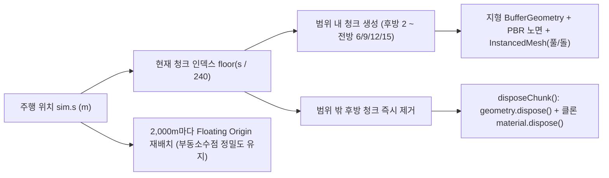

# STEPPE — 1~6단계 조사 · 게임 기획 · 시스템 구조 · 확장 로드맵

## 1단계: 유사 게임 조사 비교표와 우리 게임의 차별점

공식 기술 문서, 개발자 포스트모템, 공개 포럼, 스토어 이용자 평가를 바탕으로 조사했습니다. 비공개 상용 게임의 내부 구현 방식은 확인 가능한 공식 설명과 **추정(Estimated)** 사항을 명확히 구분했습니다.

| 게임 / 데모 | 맵 · 도로 · 지형 생성 방식 | 차량 · 오토바이 물리 구현 | 성능 최적화 기법 | 풍경 · 하늘 · 소리 · 속도감 연출 | 사용자 평가 (장점 / 불만) | 확인된 기술 스택 |
|---|---|---|---|---|---|---|
| **Slow Roads** ([공식 사례](https://web.dev/case-studies/slow-roads), [개발자 Q&A](https://www.reddit.com/r/threejs/comments/1iekc71/slow_roads_20_endless_procedurallygenerated/)) | 절차적 스플라인 도로 + 주변 높이맵 청크 스트리밍(무한 생성) | 자체 제작 경량 아케이드 차량 물리(범용 물리 엔진 미사용) | 도로 거리별 지형 LOD, 지오메트리·버퍼 풀링 재사용, 안개·인스턴싱 | 절차적 하늘·구름, 타이어 노면음·바람음, 미니멀 UI | **장점**: 설치 없는 즉각 실행, 힐링 주행 감각, 가벼운 성능 **불만**: 도로 밖 지형/충돌 처리의 단순함, 초기 환경 반복감 | Three.js, WebGL, 자체 JS 물리/청크 엔진 |
| **Traffic Rider** ([Google Play](https://play.google.com/store/apps/details?hl=en_CA&id=com.skgames.trafficrider)) | 직선·완만한 곡선 도로 타일 프리팹을 앞쪽으로 무한 이어 붙이는 방식(**내부 알고리즘 추정**) | 1인칭 아케이드 바이크 이동·기울임(정밀 이륜 강체 물리 아님, **추정**) | 짧은 가시거리 안개, 모바일용 저폴리곤 차량 프리팹 풀링(**추정**) | 실차 녹음 엔진음, 시간대(낮/노을/밤) 색조, 근접 추월 카메라 흔들림 | **장점**: 뛰어난 속도감과 엔진 사운드, 직관적 조작 **불만**: 제한 시간·미션 실패 스트레스, 과금/광고 유도 | Unity 엔진 기반(**추정**) |
| **RIDE 5** ([물리 소개](https://ride5.ridevideogame.com/ride-5-and-the-importance-of-physics-in-turning-numbers-into-emotions/), [Reddit 후기](https://www.reddit.com/r/ride5/comments/1iazitd)) | 실존 서킷·로드 트랙을 정밀 모델링한 고정 맵 | 타이어 접지(Pacejka 계열 추정), 서스펜션 피치/전후 하중 이동, 앞·뒤 브레이크 분리, 라이더 체중 이동 | 트랙 구간별 HLOD, 콘솔/PC용 셰이더·그림자 캐스케이드 | 부피감 있는 절차적 구름, 노면 젖음 반사, 고회전 배기음 | **장점**: 사실적인 린 앵글과 제동·서스펜션 감각 **불만**: 초보자에게 높은 진입장벽과 슬립 회복 난도 | Unreal Engine 4 |
| **Euro Truck Simulator 2** ([맵 설계](https://blog.scssoft.com/2012/04/map-is-never-big-enough.html), [물리 업데이트](https://blog.scssoft.com/2026/01/158-update-physics-collisions-changes.html?m=1)) | 실제 유럽 도로망을 약 1:19 비율로 압축해 수작업+툴로 제작한 대규모 고정 월드 | 다단 변속기, 엔진 토크 곡선, 캐빈·섀시 서스펜션, 크루즈 컨트롤 | 섹터 기반 월드 스트리밍, 원거리 빌보드/LOD 모델 | 긴 황혼·하늘 그라데이션, 정속 주행 크루즈와 라디오·바람 소리 | **장점**: 장거리 크루징의 독보적인 여유와 몰입감 **불만**: 단조로운 구간에서의 졸음·외로움 | Prism3D 자체 엔진 |
| **Forza Horizon 5** ([바이옴 설계](https://news.xbox.com/en-us/2021/07/26/exploring-the-biomes-and-seasons-of-forza-horizon-5/), [포토 모드](https://forza.net/news/forza-horizon-5-explore-the-horizon)) | 사진측량(Photogrammetry)과 절차적 식생 배치를 결합한 11개 바이옴 오픈월드 | 고주파 타이어·서스펜션 시뮬레이션 + 접근성 높은 아케이드 보조 | GPU 인스턴싱, 가상 텍스처, 동적 해상도 및 거리별 식생 밀도 | 12K HDR 하늘 스카이돔, 지평선 대기 산란, 바이옴별 노면/모래 연출 | **장점**: 압도적인 풍경 전환(초원·사막·해안)과 사진 촬영의 즐거움 **불만**: 수십~백 GB 설치 용량, 웹 환경에 직접 이식 불가 | ForzaTech 자체 엔진 |
| **Three.js / Babylon.js 주행 데모** ([Babylon/Havok 사례](https://forum.babylonjs.com/t/babylon-toolkit-havok-vehicle-physics-system/62636)) | 단일 높이맵 지형 또는 짧은 순환 트랙 | RaycastVehicle(Cannon-es, Rapier, Havok) 기반 4륜 레이캐스트 | WebGL2 InstancedMesh, 압축 텍스처 | 기본 PBR 재질과 환경맵(IBL) | **장점**: 브라우저 즉시 실행, 소스 구조 파악 용이 **불만**: 2륜 오토바이의 자연스러운 린(Lean) 제어 부재, 고속 주행 시 지형 이음매 바퀴 튐 현상 | Three.js / Babylon.js + Rapier / Cannon-es / Havok |

### 우리 게임(`STEPPE v1.3`)에 가져올 점과 피할 점

- **가져올 점**:
  1. **Slow Roads**의 무설치 정적 웹 구조, 청크 기반 무한 도로 생성, 가벼운 커스텀 주행 물리, 크루즈 및 차로 유지 보조.
  2. **Forza Horizon 5**의 바이옴 전환 감각(초원 → 호숫가 → 고비 사막)과 HDR 하늘·대기 원근감, 다양한 노면(포장·균열·자갈·흙)의 시각·청각적 변화.
  3. **ETS2**의 정속 크루즈(40·60·80·100km/h)와 길가 풍경(전신주, 표지판, 가축, 게르, 오보)이 주는 여행의 정취.
  4. **RIDE 5**의 오토바이 코너링 린 앵글(차체·라이더 기울임)과 가감속 시 서스펜션 피치 반응.
- **피할 점**:
  1. **Traffic Rider**식의 제한 시간, 충돌 게임오버, 점수·경쟁·과금 UI 등 풍경 감상을 방해하는 요소.
  2. 무거운 범용 물리 엔진(Rapier/Havok 등)의 3D 메시 충돌기를 모든 청크에 생성해 발생하는 청크 경계 바퀴 튐 현상과 가비지 컬렉션 스터터링.
  3. 과도한 블룸(Bloom)·모션 블러·카메라 흔들림으로 멀리 있는 산맥과 초원 시야를 흐리는 후처리.

---

## 2단계: 게임 기획서 (핵심 경험 · 주행 규칙 · 몽골 환경 · UI · 조작)

### 2.1 핵심 경험과 화면 흐름
- **핵심 경험**: *"경쟁도 실패도 없이, 끝없이 펼쳐진 몽골의 초원·호수·고비 사막을 내 속도로 달리는 자유로운 오픈 로드 여행."*
- **화면 흐름**:
  1. **출발 카드(시작 화면)**: 실시간 3D 초원 풍경과 펄럭이는 몽골 국기·염소 무리를 배경으로 **함께할 차량**(오토바이 / 탐험 왜건 자동차)과 **오늘의 주행 모드**(관광 최대 100km/h / 스피드 최대 180km/h)를 고른 뒤 `초원으로 출발` 클릭.
  2. **자유 주행 화면**: 좌측 하단 소형 계기판(속도, 기어, RPM 바, 현재 노면, 누적 거리, 린/롤 각도), 하단 중앙 소형 크루즈 패널(`40`·`60`·`80`·`100`·`수동`), 우측 상단 차량·시점·소리·설정·일시정지 도구만 남기고 화면 중앙 85% 이상을 풍경에 양보.
  3. **설정 및 일시정지**: 주행 중 언제든 그래픽 품질(`낮음`·`중간`·`높음`·`최상`), 주행 모드, 차로 유지 보조, 노면 진동, 계기판 표시 여부, 엔진음·바람음 볼륨을 즉시 바꿀 수 있음.

### 2.2 실제 몽골 도로 조사 및 반영 근거
- **통행 방향**: **우측통행(Right-hand traffic)**. 몽골 도로교통법([LegalInfo.mn](https://legalinfo.mn/en/edtl/16758728204231))에 따라 차량은 도로 우측 차로(`offset = -1.75m`)를 기준으로 주행합니다.
- **도로 폭과 길어깨**: 왕복 2차로 포장 폭 **7.0m (차로당 3.5m)** + 양측 비포장 자갈 길어깨 각 **2.2m**. JICA 몽골 동부 간선도로 설계 보고서([JICA Report p.2-14](https://openjicareport.jica.go.jp/pdf/11785508_01.pdf#page=41))의 2차로 간선도로 폭원 사례를 참고했습니다.
- **도로 표지판**: 몽골 간선도로의 청색 바탕·백색 키릴 문자 이정표 형태([Traffic Institute MN](https://www.traffic-institute.mn/c_rule/c-01/c-01-03/eng/c-01-03e-h1-1.html))를 참고하여 `УЛААНБААТАР`(울란바토르), `ДАЛАНЗАДГАД`(달란자드가드), `ХАРХОРИН`(하르호린) 표지판을 길가에 배치했습니다.
- **몽골 국기**: 공식 비율 **2:1**과 붉은색·파란색·붉은색 3등분, 좌측 붉은 칸 중앙의 황금색 **소욤보(Soyombo)** 문양(불꽃 3갈래, 해와 초승달, 상하 삼각형, 상하 수평 직사각형, 중앙 태극 어문, 좌우 기둥)을 확인하여 `dist/assets/mongolia.svg`에 반영했습니다.

### 2.3 노면 및 바이옴 설계
| 노면 종류 | 마찰 계수 (`grip`) | 구름 저항 (`drag`) | 진동 진폭 (`rough`) | 시각 재질 (Poly Haven CC0) | 음향 특징 |
|---|---:|---:|---:|---|---|
| **포장도로 (`asphalt`)** | 1.00 | 0.15 | 0.0030 | `asphalt_04` (색상+노멀) | 매끄러운 타이어 구름음 |
| **갈라진 도로 (`cracked`)** | 0.92 | 0.22 | 0.0085 | `asphalt_02` (균열 색상+노멀) | 잔잔한 균열 통과음 |
| **비포장 자갈길 (`gravel`)** | 0.74 | 0.42 | 0.0170 | `gravel_road` (자갈 색상+노멀) | 고주파 자갈 튀는 마찰음 증가 |
| **비포장 흙길 (`dirt`)** | 0.68 | 0.52 | 0.0140 | `dirt_floor` (흙 색상+노멀) | 둔탁한 흙길 마찰음 |
| **초지 · 도로 밖 (`grass`)** | 0.48 | 1.15 | 0.0240 | `sparse_grass` + 멀티스케일 셰이더 | 감속 저항 및 진동 증가 |

---

## 3단계: 기술 스택과 시스템 구조

### 3.1 기술 선택과 이유
- **렌더링 엔진**: **Three.js r180 (WebGL2)**
  - 기존 코드(`v1.2`)가 Three.js r180 ES 모듈 기반으로 구축되어 있어 호환성을 100% 유지하면서 PBR 노멀맵, HDR 환경광(PMREM), `InstancedMesh`, 커스텀 셰이더(`onBeforeCompile`)를 가장 효율적으로 확장할 수 있습니다.
- **물리 구현**: **자체 60Hz 고정 시간 간격(Fixed-Timestep) 결정론적 차량/바이크 시뮬레이션 (`dist/simulation.js`)**
  - Cannon-es나 Rapier 같은 범용 강체 물리 엔진은 240m마다 생성·파기되는 지형 청크 경계에서 바퀴 레이캐스트가 미세하게 튀거나 오토바이의 자연스러운 코너링 린 앵글을 제어하기 위해 별도의 보정 토크가 필요합니다. 자체 경량 시뮬레이션은 도로 중심선 해석 함수(`roadX`, `roadY`, `roadSlope`, `roadCurve`)와 삼각형 보간 높이(`terrainSurfaceY`)를 직접 참조하므로 **1시간 이상 장거리 주행에서도 메모리 누수나 물리 발산 없이 60Hz로 정확히 동작**합니다.
- **사운드 엔진**: **Web Audio API 실시간 절차적 합성 (`dist/audio.js`)**
  - 외부 대용량 오디오 파일 로딩 없이 오토바이 단기통/2기통 배기음과 자동차의 중저음 다기통 엔진음, 속도에 비례하는 바람 소리, 노면(자갈·흙·초지)에 따른 타이어 마찰 노이즈를 실시간 합성합니다.

### 3.2 무한 도로 청크 스트리밍과 메모리/성능 관리

### 3.3 그래픽 품질 4단계 프리셋 (`dist/world.js`)
| 품질 단계 | 전방 청크 수 (`ahead`) | 가시거리 | 청크당 풀 인스턴스 (`grass`) | 최대 픽셀 비율 (`pixel`) | 그림자 해상도 (`shadow`) | 이방성 필터링 (`aniso`) |
|---|---:|---:|---:|---:|---:|---:|
| **낮음 (`low`)** | 6개 | 약 1.44 km | 1,200개 | 1.00 | 그림자 끔 | 2x |
| **중간 (`medium`)** | 9개 | 약 2.16 km | 3,800개 | 1.50 | 1024×1024 | 4x |
| **높음 (`high`)** | 12개 | 약 2.88 km | 8,500개 | 2.00 | 2048×2048 | 8x |
| **최상 (`ultra`, PC 기본)** | 15개 | 약 3.60 km | 14,500개 | 2.25 | 4096×4096 | 16x |

---

## 4단계: MVP 범위와 v1.3 구현 완료 범위

| 구분 | 항목 | 상태 | 비고 |
|---|---|---|---|
| **MVP (v1.0~v1.2)** | 무한 초원 도로, 오토바이+자동차, 4개 시점, 크루즈(40/60/80/100), 관광/스피드 모드, 축소형 HUD, 터치/키보드/마우스 조작 | **구현 완료** | 브라우저 설정(`localStorage`) 저장 포함 |
| **v1.3 그래픽** | `최상(Ultra)` 품질 옵션 및 PC 기본값, 4K 하늘+1K HDR 환경광, 멀티스케일 지형 셰이더, 7잎 풀 인스턴싱 | **구현 완료** | 설정에서 언제든 `낮음`~`최상` 전환 가능 |
| **v1.3 도로·바이옴** | 포장·갈라진 도로·자갈길·흙길 4종 PBR 노면, 초원·호숫가·고비 사막 3종 바이옴 전이 | **구현 완료** | 노면별 접지력·진동·타이어 마찰음 연동 |
| **v1.3 몽골 풍경** | 몽골 국기(2:1·소욤보·펄럭임), 염소(뿔·귀·수염·발굽·모션), 양·말·쌍봉낙타, 게르(토오노·태양광), 오보(하닥), 키릴 표지판 | **구현 완료** | 출발 32m 앞 우측 첫 국기+염소 배치 |
| **확장 단계 (6단계)** | 시간대(아침/낮/노을/밤)·날씨(비/흐림), 수동 기어·앞뒤 브레이크 분리, 자유 카메라·사진 모드, 배경음악(BGM) | **로드맵 편성** | 아래 6단계 확장 로드맵 참조 |

---

## 5단계: 실제 지형(DEM) 검토 및 사용 자료·라이선스 명세

### 5.1 SRTM · Copernicus DEM 실제 지형 데이터 검토
| 구분 | 실제 DEM (SRTM 30m / Copernicus GLO-30) | 절차적 지형 생성 (현재 `STEPPE v1.3` 채택) |
|---|---|---|
| **장점** | 실제 몽골 특정 지역(예: 오르혼 계곡, 테를지, 홍고린 엘스)의 거시적 고도 분포와 산맥 능선을 재현 가능 | 파일 용량 **0 KB**, 끝없는 무한 주행 가능, 도로 중심선(`roadY`)과 지형 높이를 수학적으로 완벽히 일치시켜 단차 발생 없음 |
| **단점** | **30m 해상도 한계**: 폭 7m 도로의 노면 경사, 길어깨 배수로, 작은 구릉·자갈 요철을 전혀 표현하지 못함. 수십 km 분량 타일을 정적 웹에 포함하면 초기 로딩 용량이 수~수십 MB 증가하며 타일 경계 스티칭 필요 | 실제 위성 지도상의 특정 GPS 좌표와 1:1 대응하지 않음 (창작된 가상 몽골 드라이브 코스) |
| **처리 방법 및 라이선스** | GeoTIFF 다운로드 → GDAL로 관심 영역 클리핑 및 Web Mercator/로컬 미터 좌표 변환 → 16-bit PNG 하이트맵 압축 → 도로 스플라인 주변 가우시안 평탄화 마스킹. - **SRTM (USGS)**: Public Domain ([USGS 안내](https://www.usgs.gov/faqs/where-can-i-get-global-elevation-data)) - **Copernicus DEM GLO-30**: 무료 이용 가능하나 공식 출처 문구 표기 의무 ([Copernicus 라이선스](https://dataspace.copernicus.eu/explore-data/data-collections/copernicus-contributing-missions/collections-description/COP-DEM)) | 결정론적 다중 주파수 해시 노이즈(`noise`) + 바이옴 가중치(`gobiFactor`, `waterFactor`) + 삼각형 정점 보간(`terrainSurfaceY`). |

### 5.2 실제 사용한 모든 자료와 라이선스 표
사이트 전체가 동일 라이선스라고 가정하지 않고 **개별 에셋 페이지의 라이선스와 제작자**를 모두 확인했습니다. 아래 사진 기반 텍스처와 하늘 HDRI는 사실적인 재질·조명 표현을 위해 사용한 CC0 자료이며 **실제 몽골 현장에서 촬영된 사진이 아닙니다.**

| 자료 이름 | 구분 | 제작자 | 원본 링크 | 라이선스 | 게임 내 수정 · 사용 내용 |
|---|---|---|---|---|---|
| **Three.js r180** | 3D 렌더링 라이브러리 | Three.js Authors | https://threejs.org/ | MIT | `dist/vendor/three.module.js`, `HDRLoader.js` 로컬 포함 |
| **Sparse Grass** | 초원 지면 PBR 재질 | Rob Tuytel (Poly Haven) | https://polyhaven.com/a/sparse_grass | **CC0 1.0** | `sparse_grass_diff_1k.jpg`, `sparse_grass_nor_gl_1k.jpg` (1024×1024 JPEG, 멀티스케일 셰이더 합성) |
| **Aerial Grass Rock** | 초원 보조 재질 | Poly Haven | https://polyhaven.com/a/aerial_grass_rock | **CC0 1.0** | `aerial_grass_rock_diff.jpg`, `aerial_grass_rock_nor.jpg` (512×512 JPEG 리사이즈) |
| **Asphalt 04** | 포장도로 PBR 재질 | Poly Haven | https://polyhaven.com/a/asphalt_04 | **CC0 1.0** | `asphalt_04_diff.jpg`, `asphalt_04_nor.jpg` (512×512 JPEG 리사이즈) |
| **Asphalt 02** | 갈라진 도로 PBR 재질 | Rob Tuytel (Poly Haven) | https://polyhaven.com/a/asphalt_02 | **CC0 1.0** | `asphalt_02_diff_1k.jpg`, `asphalt_02_nor_gl_1k.jpg` (1024×1024 JPEG) |
| **Gravel Road** | 비포장 자갈길 PBR 재질 | Poly Haven | https://polyhaven.com/a/gravel_road | **CC0 1.0** | `gravel_road_diff.jpg`, `gravel_road_nor.jpg` (512×512 JPEG 리사이즈) |
| **Dirt Floor** | 비포장 흙길 PBR 재질 | Poly Haven | https://polyhaven.com/a/dirt_floor | **CC0 1.0** | `dirt_floor_diff.jpg`, `dirt_floor_nor.jpg` (512×512 JPEG 리사이즈) |
| **Sandy Gravel 02** | 길어깨 · 사막 자갈 재질 | Poly Haven | https://polyhaven.com/a/sandy_gravel_02 | **CC0 1.0** | `sandy_gravel_02_diff.jpg`, `sandy_gravel_02_nor.jpg` (512×512 JPEG 리사이즈) |
| **Kloofendal Partly Cloudy (Pure Sky)** | 4K 배경 하늘 · 1K HDR 반사 | Greg Zaal, Jarod Guest (Poly Haven) | https://polyhaven.com/a/kloofendal_48d_partly_cloudy_puresky | **CC0 1.0** | `sky_4k.jpg` (4096×2048 JPEG 압축), `sky_1k.hdr` (1024×512 HDR 환경광). *남아프리카 촬영 자료이며 몽골 현장 사진 아님* |
| **Flag of Mongolia** | 몽골 국기 SVG | Wikimedia Commons / 국가 상징 | https://commons.wikimedia.org/wiki/File:Flag_of_Mongolia.svg | **Public Domain** | 2:1 비율 및 소욤보 문양 확인 후 `dist/assets/mongolia.svg`로 경량화 |
| **오토바이 · 탐험 왜건 · 염소 · 양 · 말 · 쌍봉낙타 · 게르 · 오보 · 표지판 · 산맥 · 풀잎** | 3D 절차적 모델 | 본 프로젝트 직접 제작 (`bike.js`, `car.js`, `scenery.js`, `world.js`) | 프로젝트 내 원본 코드 | 자체 제작 (Original) | 외부 3D 모델 파일 없이 Three.js 지오메트리 조합 및 정점 변형으로 직접 구현 |
| **엔진음 · 바람음 · 노면 타이어 마찰음** | 실시간 합성 사운드 | 본 프로젝트 직접 제작 (`audio.js`) | 프로젝트 내 원본 코드 | 자체 제작 (Original) | 외부 음원 파일 없이 Web Audio API 오실레이터·필터·노이즈 버퍼로 실시간 합성 |

---

## 6단계: 향후 확장 로드맵

| 단계 | 확장 주제 | 세부 구현 계획 | 완료 검증 기준 |
|---|---|---|---|
| **Phase 6-1** | **시간대(아침·낮·노을·밤)와 날씨(맑음·흐림·바람·비)** | 태양 고도각(`sunElevation`)에 따른 DirectionalLight 색온도·그림자 길이·하늘 셰이더 보간, 야간 오토바이/자동차 전조등(`SpotLight`) 활성화, 비/바람 시 노면 거칠기(`roughness`) 감소 및 접지력(`grip`) 15~25% 하향 | 야간·우천 시에도 도로 시인성이 확보되고 품질 `낮음`에서 프레임 저하가 없는가 |
| **Phase 6-2** | **자유 카메라 및 사진 모드(Photo Mode)** | 일시정지 상태에서 차량 주변 구면 좌표계 회전·줌·피사계 심도/구도 조절 후 HUD를 제외한 캔버스를 `toDataURL('image/png')`로 즉시 다운로드 | PC 마우스 드래그와 모바일 핀치/드래그로 구도 조절 및 PNG 저장이 정상 동작하는가 |
| **Phase 6-3** | **오토바이 수동 변속 및 앞·뒤 브레이크 분리** | 설정에서 `자동 / 수동 변속(Q/E)` 및 `통합 / 전·후륜 브레이크 분리` 토글 제공. 비포장길에서 전륜 급제동 시 프론트 슬립 위험도와 후륜 브레이크의 안정적 감속 차이 구현 | 입문자는 기본 자동 모드로 편하게 즐기고, 숙련자는 수동 조작의 재미를 느끼는가 |
| **Phase 6-4** | **몽골 분위기 배경음악(BGM) 및 오디오 믹서 확장** | 개별 곡의 CC0 또는 상업 이용 허가 라이선스가 명확히 검증된 앰비언트/전통 현악 음원(또는 Web Audio 5음계 마두금풍 절차적 앰비언트 신스) 추가 및 `배경음악 볼륨` 슬라이더 활성화 | 저작권·상업적 이용 제약이 전혀 없으며 엔진음·바람음과 자연스럽게 어우러지는가 |
| **Phase 6-5** | **실측 DEM 하이트맵 선택 코스 모드** | Copernicus GLO-30에서 추출·경량화한 실제 몽골 명소(오르혼 계곡 등) 16-bit PNG 하이트맵 타일을 선택형 코스로 추가하고 출처 문구 표기 | 무한 절차적 코스와 실측 명소 코스를 사용자가 선택할 수 있는가 |
